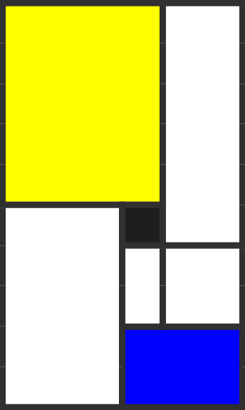

# Mondrian Clock Web

A browser-based clock with Mondrian-style design where no two minutes repeat within the 88-billion-year period.

**[▶ Live Demo](https://hraj.si/now)** · **[Wallpaper Engine](https://steamcommunity.com/sharedfiles/filedetails/?id=3125524524)**

## Usage

Just open `index.html` in any browser.

## URL Parameters

- `origin` - Custom epoch (ISO 8601 format, e.g., `2000-01-01T00:00:00Z`)
- `offset` - Year offset from origin
- `period` - Time unit in minutes (1=minutes, 60=hours, 3600=days)
- `mod` - Modulus for display (default: 60)
- `hours` - Hour panel: `12` (default) a 12-hour dial, lit area = elapsed share of 12 h; `day` a 24-hour dial, share of the day; `24` the hour 0–23 as a sum of weights
- `tz=utc` - Minute and hour panels in UTC instead of local time

Example: `https://hraj.si/now?origin=2000-01-01T00:00:00Z`

## Click Interaction

Click the clock to cycle through display modes:
- **Seconds** (default): Pattern changes every second within minute
- **Minutes**: Lit area = minute of the hour, local time
- **Hours**: The hour panel (`hours`), local time
